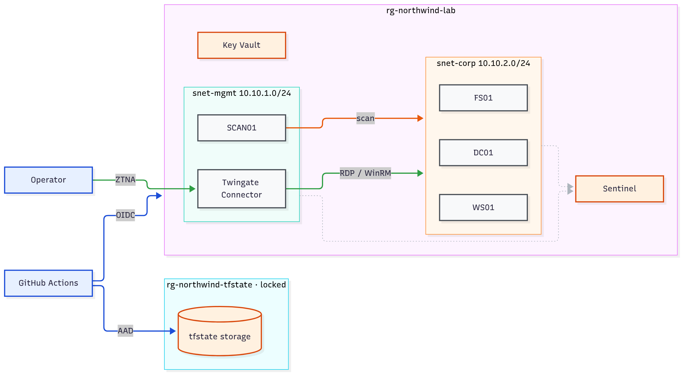

# Northwind Dental — Detection Engineering Lab

A 25-user fake company built as code in Azure (AD + Entra ID), reached only through
Twingate ZTNA, attacked via a simulated phishing chain, and monitored in Microsoft
Sentinel. Fully destroyable and rebuildable with `make up` / `make down`.

See `PLAN.md` for the full phased project plan.

## Cost strategy (target: free trial credits, then ≤ $20/month)

The only things that should ever run 24/7 are:
- The Twingate Connector VM (smallest size available)
- The managed OS disks for DC01/WS01/FS01 (disks bill even when the VM is deallocated)

Everything else — DC01, WS01, FS01 compute — gets **fully deallocated** between
work sessions via `make down`, not just stopped in the OS. Stopped-but-allocated
VMs still bill for compute; deallocated VMs do not.

Sentinel is enabled *last* (Phase 3), after the lab is fully built, so the 31-day
free trial (ingestion + Sentinel charges waived up to 10GB/day) covers the
attack/detection phases instead of being wasted during setup.

A budget alert is created in this very first stack, before any other resource
exists, set at $15 to leave headroom under the $20 ceiling.

## Repo layout

```
terraform/
  00-foundation/   # budget alert, remote state, Key Vault
  05-policy/       # Azure Policy as code (no public IP, require tags, allowed locations)
  10-network/      # VNet, mgmt/corp subnets, NSGs (no public inbound anywhere)
  15-access/       # Twingate connector + resources (admin + toggleable red-team)
  20-compute/      # DC01, WS01, FS01 + auto-shutdown schedules
  30-identity/     # Entra users/groups
  40-sentinel/     # workspace, Sentinel, detections as code
ansible/           # domain promotion, users, telemetry, weaknesses, Nessus on SCAN01
.github/workflows/ # CI (fmt/lint/scan), manual OIDC apply, scheduled drift detection
grc/               # risk register, control mapping, defense-in-depth, IR runbook
data/users.csv     # fake employee roster
attack-chain/      # attack log + ATT&CK mapping
detections/        # one file per detection rule
evidence/          # sanitized screenshots/logs
coverage.md        # what was detected, missed, and why
```

## Architecture



Grounded in the current Terraform (`00-foundation` … `40-sentinel`). **No public
IPs and no internet-facing endpoints anywhere** — all inbound access is Twingate
ZTNA (operator) or the Azure control plane (CI/CD).

| Access path | Colour | What it is |
|---|---|---|
| Admin | green | Operator → Twingate Connector → corp hosts (RDP / WinRM) |
| SCAN01 → corp | orange | Permanent, narrow: SCAN01 `10.10.1.11/32` → corp on scan ports |
| CI/CD | blue | GitHub Actions → OIDC → Azure ARM; AAD token → tfstate storage |
| Telemetry | grey dotted | Azure Monitor Agent on the VMs → Log Analytics / Sentinel (`law-northwind-lab`) |

Diagram source: [`docs/architecture.mmd`](docs/architecture.mmd) — regenerate with
`mmdc -i docs/architecture.mmd -o docs/architecture.png -s 3`. VM sizes: connector
`Standard_F1als_v7`; DC01/WS01/FS01 and SCAN01 `Standard_B2s`. A trust-boundary
data-flow view is in [`grc/data-flow-diagram.md`](grc/data-flow-diagram.md).

## CI/CD and GRC

- **CI** (`.github/workflows/ci.yml`): `terraform fmt`, TFLint, Checkov,
  gitleaks, and ansible-lint run on every PR. Nothing merges to `main` with
  a known misconfiguration pattern or a leaked secret.
- **Apply** (`terraform-apply.yml`): manual trigger only, authenticated via
  Azure OIDC (no stored cloud credentials in the repo), gated behind a
  GitHub Environment approval.
- **Drift detection** (`drift-detection.yml`): scheduled `terraform plan`
  against live Azure, opens an issue if reality has diverged from what's
  committed - catches changes CI never sees, like a manual portal edit.
- **`grc/`**: a risk register for every deliberate weakness and toggle, a
  CIS Controls v8 mapping, and - importantly - `defense-in-depth.md`,
  which documents what this pipeline *can't* catch (business-logic flaws,
  supply-chain risk, zero-days) and why the Sentinel detection layer exists
  as the other half of the story, not a redundant one.

## Usage

```
make init      # terraform init on all stacks
make up        # apply foundation -> network -> access -> compute
make down      # deallocate compute, leave foundation/state/KV intact
make destroy   # tear down everything including state (rarely used)
```
