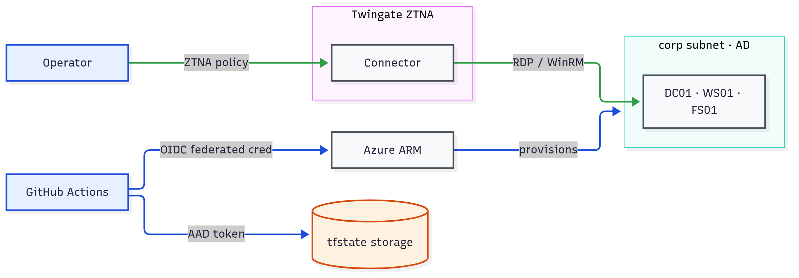

# Trust-boundary data-flow diagram

Legitimate data flows and the trust-boundary crossings for the lab, each labelled
with what authenticates it. Useful as the architecture / scope figure in a
pentest report's methodology section.

Diagram source: [`data-flow-diagram.mmd`](data-flow-diagram.mmd) — regenerate with
`mmdc -i grc/data-flow-diagram.mmd -o grc/data-flow-diagram.png -s 3`.

## Boundary crossings and what authenticates each

| Crossing | Flow | Authenticated by |
|---|---|---|
| External → ZTNA | operator → Twingate Connector | Twingate ZTNA policy (device posture + IdP identity); the connector has **no inbound ports** |
| ZTNA → corp (AD) | connector → DC01 / WS01 / FS01 | RDP / WinRM with domain credentials (operator is in the Twingate `admins` group) |
| External → Azure management plane | GitHub Actions → ARM | **OIDC federated credential** — short-lived, no stored secret in the repo |
| Management plane → infra | ARM → lab resources | Azure RBAC on the deploying principal |
| Terraform → state (data plane) | CI / operator → tfstate storage | **AAD token** + `Storage Blob Data Contributor` (shared-key auth disabled) |

## Notes

- Every legitimate boundary crossing uses a short-lived or policy-gated credential
  (ZTNA session, OIDC, AAD token) — there are **no long-lived secrets or stored
  cloud credentials** in the repo; generated secrets live only in Key Vault.
- The resource-level companion to this flow view is the architecture diagram in
  the root `README.md`. Keep both (and the `.mmd` sources) in sync with the
  Terraform.
