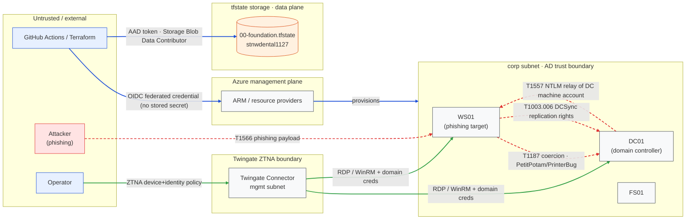

# Trust-boundary data-flow diagram

Data flows and the trust-boundary crossings for the lab, each annotated with what
authenticates it. **Legitimate** access flows are solid; the **simulated attack
chain** is overlaid as a distinct dashed-red flow so the compromise path is
visually separate from normal operations. This is the figure to drop into the
methodology / architecture section of a pentest report.

## Boundary crossings and what authenticates each

| Crossing | Flow | Authenticated by |
|---|---|---|
| External → ZTNA | operator → Twingate Connector | Twingate ZTNA policy (device posture + IdP identity); the connector itself has **no inbound ports** |
| ZTNA → corp (AD) | connector → DC01 / WS01 / FS01 | RDP / WinRM with domain credentials (operator is in the Twingate `admins` group) |
| External → Azure management plane | GitHub Actions → ARM | **OIDC federated credential** — short-lived, no stored secret in the repo |
| Management plane → infra | ARM → resources in corp/mgmt | Azure RBAC on the deploying principal |
| Terraform → state (data plane) | CI / operator → tfstate storage | **AAD token** + `Storage Blob Data Contributor` (shared-key auth disabled) |
| Attack chain (illegitimate) | phishing → WS01 → DC01 → relay → DCSync | **nothing legitimate** — this is the simulated compromise the `detections/` rules exist to catch; see `attack-chain/` and `coverage.md` |

## Notes

- The attack chain crosses the **corp AD trust boundary internally** (WS01 → DC01)
  — it never crosses the ZTNA or management-plane boundaries. The ZTNA perimeter
  is assumed already passed (a compromised endpoint session), which is exactly
  what the toggleable red-team path in `15-access` / `10-network` models.
- Every legitimate boundary crossing uses a short-lived or policy-gated credential
  (ZTNA session, OIDC, AAD token) — there are **no long-lived secrets or stored
  cloud credentials** in the repo. Generated secrets live only in Key Vault.
- Keep this diagram in sync with the Terraform; the architecture view in the
  root `README.md` is the resource-level companion to this flow-level view.
